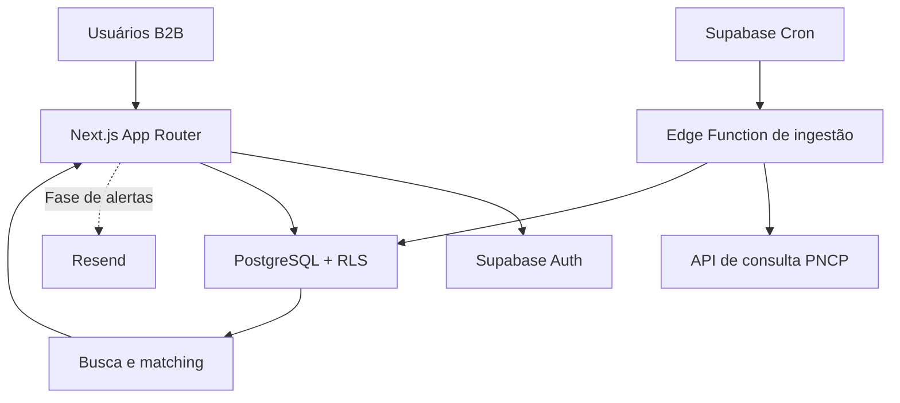

# Arquitetura do Edital Certo

## Visão do MVP



O catálogo de licitações é compartilhado e contém dados públicos. Perfis, preferências, favoritos, alertas e pipeline pertencem a uma organização. As consultas da aplicação usam a sessão Supabase e RLS; somente a função de ingestão recebe credencial privilegiada.

## Decisões técnicas

| Tema | Decisão | Motivo |
|---|---|---|
| Aplicação | Next.js App Router e TypeScript | Interface responsiva, páginas públicas estáticas e páginas de conta renderizadas no servidor |
| Autenticação | Supabase Auth com `@supabase/ssr` | Sessão em cookies para renderização do servidor, senha e magic link |
| Isolamento | PostgreSQL RLS, `organization_id` e papéis | A autorização é aplicada no banco mesmo quando uma consulta da interface é alterada |
| Fontes públicas | Conectores sob `ProcurementConnector` | O normalizador separa campos internos do formato próprio de cada portal; novas fontes podem ser acrescentadas sem misturar tabelas de domínio |
| Ingestão | Edge Function, chamadas paginadas e upsert por chave da fonte | A execução pode ser repetida, retentada e retomada por checkpoint |
| Busca | `tsvector` português, `unaccent`, índices GIN e RPC invoker | Ranking e filtros são executados no Postgres com parâmetros tipados e RLS do chamador |
| Planos | `plans`, `subscriptions` e triggers de cota | Limites críticos de perfis, palavras-chave, usuários e recursos imediatos são verificados no banco |
| Agendamento | Supabase Cron com `pg_net` e segredo no Vault | O token do job não fica em migration ou no código-fonte |
| Interface | HTML semântico, componentes Tailwind e controles nativos | A base prioriza navegação por teclado, leitores de tela e mobile-first |
| Testes | Vitest e Playwright | Lógica determinística é testada unitariamente; os fluxos públicos do navegador têm E2E |

### Conectores plugáveis

Cada conector implementa `fetchNew`, `fetchById` e `normalize`. O conector PNCP consulta publicações e converte o resultado para `NormalizedTender`. A rota `fetchById` ainda falha com mensagem explícita porque o caminho atual de detalhe precisa ser confirmado no Swagger oficial antes de assumir uma rota. A função de ingestão chama os mesmos campos normalizados de forma independente para executar no ambiente Deno.

### Estrutura de diretórios

```text
src/
  app/                 rotas e telas Next.js
  lib/connectors/      contrato comum e conectores de fontes
  lib/matching/        score determinístico e lógica de busca
  lib/security/        utilitários de segurança de entrada/saída
  lib/supabase/        clientes browser e server com SSR
supabase/
  functions/           ingestão e tarefas de servidor em Deno
  migrations/          esquema, índices, funções e políticas RLS
scripts/               verificação/captura do contrato PNCP
fixtures/pncp/          respostas reais capturadas (não são geradas)
tests/e2e/              fluxos do navegador Playwright
docs/                   arquitetura, operação e backlog
```

## Limites e próximas decisões

- O estado de foco comercial ainda não foi informado; a ingestão é nacional, e o onboarding permite limitar perfis por UF/município.
- O endpoint de detalhe e as operações de itens/arquivos precisam ser verificadas no Swagger antes de ligar a captura dessas entidades.
- Não há projeto Supabase ou conta de e-mail/pagamento vinculados; o cron horário e a entrega de alertas só podem ser ativados no ambiente de implantação.
- O modelo contém as entidades previstas para pipeline e IA, mas as telas e os processos das Fases 2 e 3 estão no backlog.
